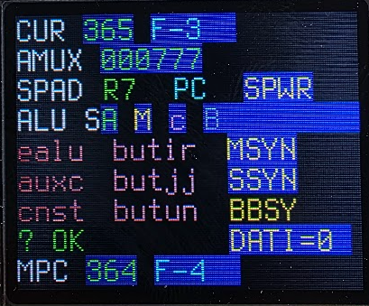
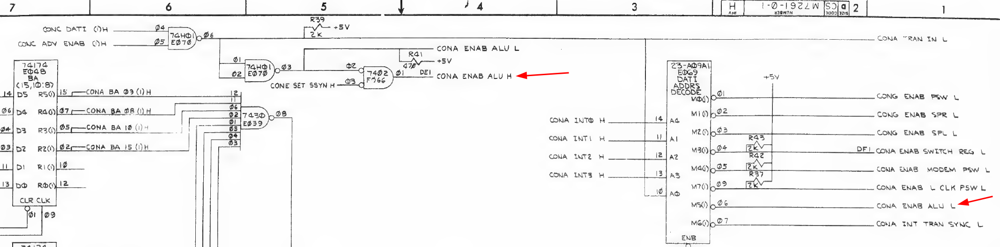
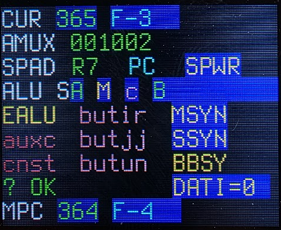
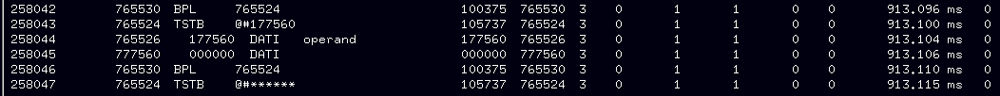

# M7261 Control #1

This board allows using the console, but running a program from memory fails.

## Initial analysis: running a program from memory

I tried to run a program from memory. I deposited just a 000777 (br .-2) at address 1000, then started from there. This did not work: the run light stayed off. I then checked 177707 (the PC) which read 000000. Not very informative. I then set the following:

| Address | Value | Why |
| ------ | ----- | ----- |
| 4 | 000006 | Bus error goes to address 6, halts, PC should show 10 |
| 6 | 000000 | Target of trap 4, halt instruction |
| 10 | 000012 | Target of illegal instruction trap, when taken PC should show 14 |
| 12 | 000000 | Target of illegal instruction trap, nop |
| 177706 | 1000 | Stack pointer, set to 1000 |

And of course the branch at 1000.

This still produced a PC = 0 - which should not be possible if anything here runs. I also examined SP, and that too remained at 1000. This probably means no traps were taken.

The machine halted, so if anything at all ran then this might mean that for some reason PC was 1777776. 

Next round:
- put a halt at 1000, then start. This delivers the same pc=0.
- put a br .-2 at 1000 (000777), then single step: switch on halt, start at 1000, then a single continue. This shows something odd: the LEDs show 1777776.

This indicates that the first fetch goes to address 1777776, not 1000. This cannot come in any way from a memory issue because every bit is different. My friend Claude reasons this:

    The address itself is the useful clue. 177776 can't come from 001000 through a stuck bit or two, since almost every bit differs. It looks much more like the bus address register (BA) holding a leftover value instead of being loaded with the PC. The 11/05's PS is a bus-addressable register at 177776, and it's plausible that the START microcode touches it, for example to clear it, just before the first fetch. If the BA load that should put the PC into BA doesn't happen, BA still holds 177776 and the fetch goes there. The register-space start could survive this because fetches from 1777xx are handled internally and never depend on that same BA transfer. The console's examine and deposit load BA through the console path, which works. So the prime suspect is the transfer of the PC into BA during instruction fetch: the BA load clock/enable in that microstep, or the multiplexer that selects what goes into BA.

    Two quick checks will confirm which side of that transfer is at fault:

    With the switch on HALT, do LOAD ADDR 1000 and START, but don't press CONT yet. Examine 177707.
    If the PC reads 001000, the PC is correct and the problem is getting it into BA, which is the BA hypothesis.
    If the PC already reads 177776, the START sequence itself loads the wrong value into the PC. Look at the load-address path instead.
    Do the same single-step experiment starting at 177700 and see what the lights show. That will tell you whether that path really bypasses the problem.

Doing that check reveals that the PC is 1000.

Next test: see whether the CPU can do Unibus reads. Deposit the following:

| Address | Value | Why |
| ------ | ----- | ----- |
| 1000   | 123456 | A value to read |
| 177700 | 013703 | MOV @#1000,R3 | 
| 177701 | 1000 | The 1000 operand of the above instr |
| 177702 | 0 | Halt |
| 177703 | 0 | Start with clearing R3 |

Running this shows that R3, after the run, holds 123456 which means that the CPU CAN read Unibus memory.

## Microstepping the code, round 1

I put a BR .-2 (000777) at address 1000, then microstep it using my [km11 replica](https://github.com/fjalvingh/km11).

Step F-2 shows correctly: the lamps show 000001, which is in preparation for doing the PC = PC + 2. The ALU op should be A + B + Carry, bringing PC + 1 + 1.

F3 should show the new PC value on the AMUX lines, i.e. 1002. Instead it shows 000777, the instruction at 1000:

It should show 1002, the result of the PC's addition.

This sounds like the AMUX is not working correctly. As all values are coming from the bus this is not one of the 8266 multiplexers but probably the selection signal from pin 9 called CONA ENAB ALU H. This signal is L.

The signal comes from the M7261, this part:

E66, 7402 (NOR gate) shows pin 1 LOW, pin 2 HIGH, Pin 3 LOW. For pin 1 to be HIGH both pin 2 and 3 need to be low. Pin 2 is CONA ENAB ALU L, coming from E069, the 23-A09A1 PROM, which is indeed high.

Looking at this PROM, its outputs are only enabled, through E039 (7430, 8 input NAND) when all high address lines are 1. The address in the BA register should be 1000, and that means this PROM is not enabled (see appendix A in this document for an explanation on what those PROMs do).

This, in turn, means that the signal must come from something else: (E070, 74H01 OC NAND Gate) P3 open collector output, which is 1. Both P1 and P2 are 0, coming from P6 on the same chip. Its inputs: P4 = 1, P5 is 1.7V; that is clearly not right. That signal is called CONC ANV ENAB 1(H)

That signal comes from E80 (7474, p8), 1.7V; p9 is 4V. Either the 7474 is dead - or one of the other trailing chips have an issue. Cutting P8 shows that the output by itself gets zero, and the PCB side is indeed at 1.7V. Forcing that PCB side to 0 and measuring current shows two things:
- The current is 2.8mA
- When applied the AMUX value changes from 000777 to 000000.
This is a clear indication that the 7474 is defective, and they are notoriously bad around this time.

Desoldering actually caused the chip to break into pieces 8-/ Replacing it with a 74LS74 (surprisingly I have a lot of 7400 series ICs but not the 7474) fixes the step:

The change made the machine run the M9312 boot for several seconds- before stopping again, so - another error to find.

## Round 2: hanging during m9312 console

The machine has trouble starting. It often hangs showing a 4 on the console lights, which is actually also the content of the PC. The logic analyzer trace shows it stops mid-instruction:

I did the same with the "br .-2" loop at 1000; this also aborts after a 25 seconds or so, this time with 1006 on the console - an address that should never be reached.

## Appendix A: The E30, E68, E69 PROMs.

The E69 PROM is not enabled, so it was not part of the issue. But I did check how that part works.

These PROMs (E030, E068, E069) handle the decoding of internal registers of the machine: 

| Address | Registers |
| ------- | --------- |
| 177700 - 177717 | R0..R17 internal registers (SPAD rams) |
| 177776 | The PSW |
| 177570-177571 | The console switch register |
| 17756X | The SCL serial console registers |
| 177546 | The line clock status register |

E030 is the main address decoder. It decodes whether whether an internal register is addressed. Its address bits are scrambled a bit in the lower parts, but addresses 300..317 say "R0..R17", and return 0001 as their data.

F-1 will have stored the PC in the BA register, and that will have been address 1000. This means that the lowest 7 bits of BA are all zeroes, which is the input for E030. At that address we have all zeroes as output. And that is what is present at F-3, and all outputs are clearly 0.
