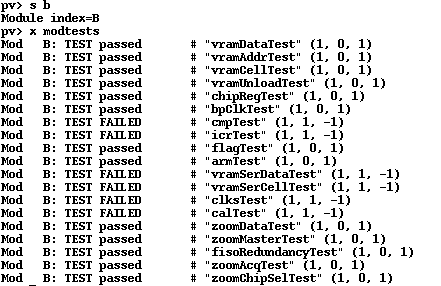
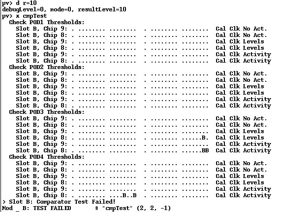
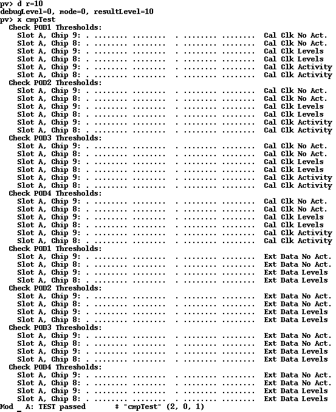
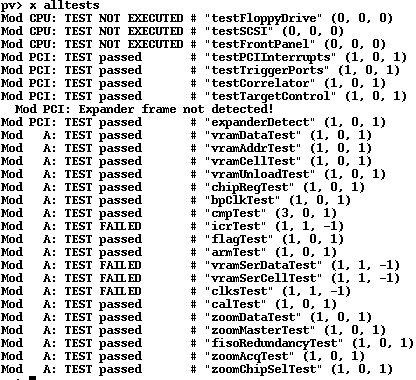
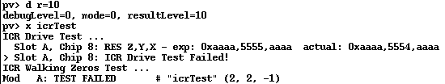
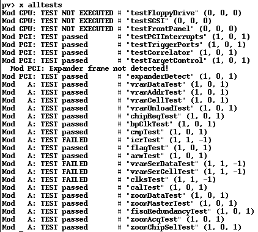

# The first HP 16717A board

I got this through Ebay. It was marked as working, but it was not, sadly enough. It still had the gliders attached and there were definite signs of corrosion. I removed all gliders, cleaned the board with Acetone and IPA 99%, and let it dry. Then I tested it using "pv" in the analyzer.

## CmpTest

First run is the cmpTest. With extra info:

We seem to have an issue with "Chip 8", on 4 bits in pod3 and pod4. The test produces a lot of "dots" that repeat twice, in the pattern 1 dot, 8 dots, 8 dots. I think that is CLK, and then two groups of 8 bits for the pod. In that case we have:

Pod 3:
- chip 8 bit 14: cal clk levels
- chip 8 bit 14 and 15: cal clk activity

Pod 4:
- chip 8 bit 12 and 15: cal clk activity

I checked between the comparators and the large FPGA around pod 3 and 4 and found 4 broken traces:

After that the cmpTest passed:

Running the whole suite now reported this:

## icrTest

This reported this:

It fails with Slot A, Chip 8: RES Z,Y,X - exp 0xaaaa,5555,aaaa  actual: 0xaaaa,5554,aaaa. That is bit 0 of something being stuck low. I checked the schematic, and assumed that the IcrTest talks about the inter-chip I/F. But that has two 24-bit buses which only go to the inter-board connectors (the white ones next to the ASICs on both bottom and top of the board).

I found some other traces around U22 (Chip 8) which were broken, and after repair the following was the result:

## Repair links

There are several resources related to the repair of these boards:

* [TubeTime's reverse engineering of the 16717A](https://github.com/schlae/hp16717) as seen on CuriousMarc
* [An earlier attempt at the same](https://github.com/bcrist/16717a)
* [eevblog main thread about these boards](https://www.eevblog.com/forum/repair/series-defect-on-agilent-167xx-boards/)

