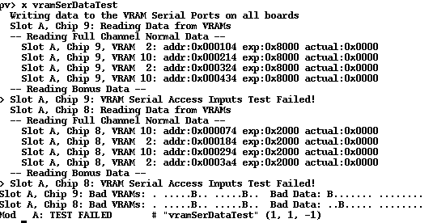
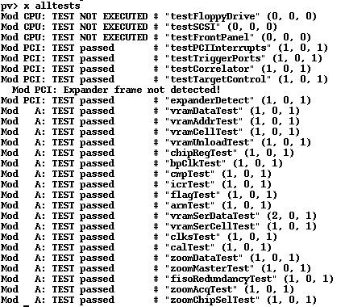
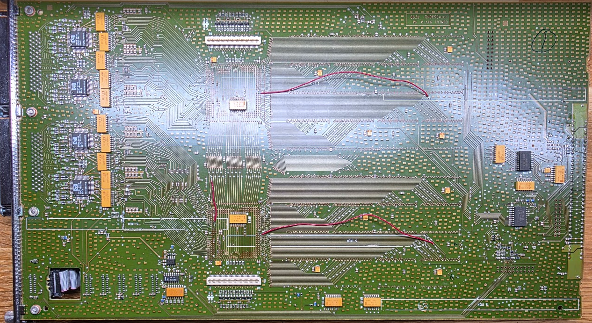

# The first HP 16717A board

I got this through Ebay. It was marked as working, but it was not, sadly enough. It still had the gliders attached and there were definite signs of corrosion. I removed all gliders, cleaned the board with Acetone and IPA 99%, and let it dry. Then I tested it using "pv" in the analyzer.

## CmpTest

First run is the cmpTest. With extra info:

We seem to have an issue with "Chip 8", on 4 bits in pod3 and pod4. The test produces a lot of "dots" that repeat twice, in the pattern 1 dot, 8 dots, 8 dots. I think that is CLK, and then two groups of 8 bits for the pod. In that case we have:

Pod 3:
- chip 8 bit 14: cal clk levels
- chip 8 bit 14 and 15: cal clk activity

Pod 4:
- chip 8 bit 12 and 15: cal clk activity

I checked between the comparators and the large FPGA around pod 3 and 4 and found 4 broken traces:

After that the cmpTest passed:

Running the whole suite now reported this:

## icrTest

This reported this:

It fails with Slot A, Chip 8: RES Z,Y,X - exp 0xaaaa,5555,aaaa  actual: 0xaaaa,5554,aaaa. That is bit 0 of something being stuck low. I checked the schematic, and assumed that the IcrTest talks about the inter-chip I/F. But that has two 24-bit buses which only go to the inter-board connectors (the white ones next to the ASICs on both bottom and top of the board).

This was caused by a very hard to find trace break running between the large ASICs (U21 and U22, on the U22 side "Chip 8"). I found it by beeping the test points on the board through to their final destination VIA.

After that the icrTest passes!! Three more failures to go..

## vramSerDataTest

This failed as follows:

There are issues on VRAM 2 and VRAM 10.
- Chip 8 (U22) has an issue with bit 13. 
- Chip 9 (U21) has an issue with data bit 15, apparently

I also ran the next test, vramSerCellTest, and it reported the same buts and the same VRAM chips, so these probably have the same cause.

Chip 8 VRAM 2 is U60.
Chip 8 VRAM 10 is U61.
Chip 9 VRAM 2 is U56.
Chip 9 VRAM 10 is U57.

These connections were hard to find, and did not really associate with the pins from the schematic. The traces are also immensely thin and very close to a whole lot of other traces and VIA's, so it took two hours to fix 2 traces. But after that I was rewarded:

This single board took about 12 hours to fix, sigh.

## Repair links

There are several resources related to the repair of these boards:

* [TubeTime's reverse engineering of the 16717A](https://github.com/schlae/hp16717) as seen on CuriousMarc. This one names the VRAM chips properly, big help.
* [An earlier (and better) attempt at the same](https://github.com/bcrist/16717a). This has a technical description, and seems a bit better than the TubeTime one.
* [eevblog main thread about these boards](https://www.eevblog.com/forum/repair/series-defect-on-agilent-167xx-boards/)

