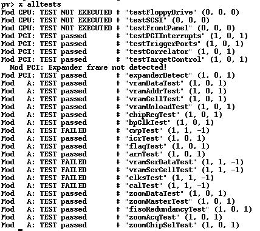
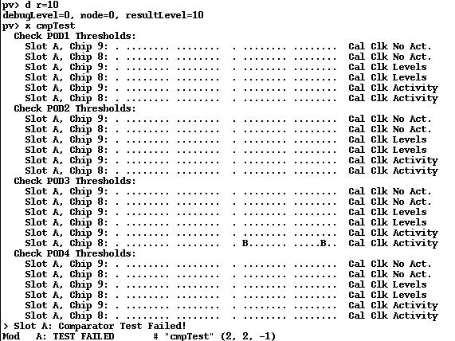
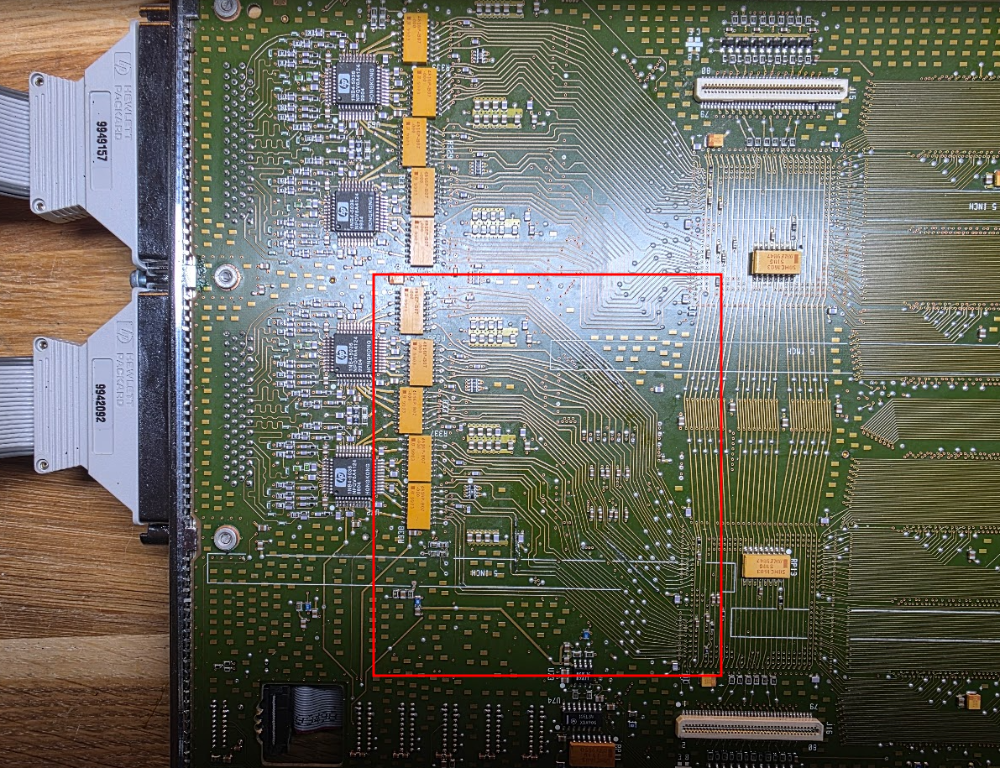
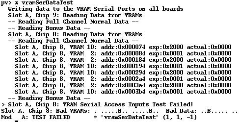

# The second HP 16717A board

Let's hope we can repair this one too ;) The initial state reported the following errors:

This looks better than the first card, actually.

## cmpTest

The cmpTest failure, with details:

Slot Chip 8 (U22) two bad bits: 0 and 13. It was in this area:

## vramSerDataTest

This one was easy too: just two traces between the RAMs and U22. After that the board also passes all tests. Easy peasy ;)
