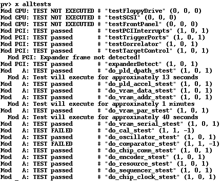
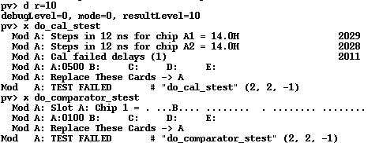

# The HP 16566A analyzer board repair

This was one of my original boards which worked when I received the analyzer, but died after.

The initial set of tests show the following:

The failed tests are:

- do_cal_stest
- do_comparator_stest

Testing these with r=10 reports:

The first test is testing channel deskew. It tells us that bit 8 and bit 10 on pod A are failing.

An initial visual check is depressing.. There is only one glider in the comparator area. It does not cover a lot of traces. But it DOES cover some via's, and some are in terrible state..

