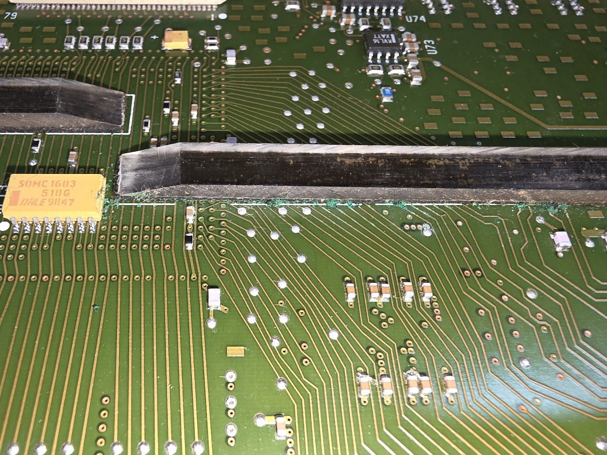

# HP 16702A Logic Analyzer

Bought from Ebay, in good state. It came with 2x HP 16556A analyzer cards, in 2021. I do not use it a lot but when I do it is a godsend, because it is immensely capable and has 136 inputs (2x 68).

## A nasty surprise

But when I needed it in 2026 I had a shitty surprise: one of the 16556A cards failed. I then found out that the analyzer cards in these machines have a terrible problem. The bottom of the card contains plastic strips (gliders) that are used to prevent scraping off SMD components from the underside of the card while inserting it. Those gliders are glued on the card, and the glue, after about 5 years, has started to eat the copper on the board... This means that traces that pass under or close to those gliders can be cut, and worse: if the crap enters a via it can destroy the via. As this is an 8-layer board this makes it very hard to repair that.. This is called the "green death" because that's the color of the corrosion:

I decided to buy two other boards (HP 16717A) which were marked as "in working order". Pretty pricy, coming from America, but I really want this machine to work.. Alas, when they did arrive they also did not work. I decided to keep them, though (and I got quite some money back from the Ebay vendor, which I thought was quite great), because around 2025/2026 there appeared on the Internet two separate schematics and reverse engineered boards. There is a CuriousMarc video that also repaired a 16717A, so that seemed... possible..

## Removing the gliders

The gliders can be removed relatively easily as follows. First, get a hard plastic spudger so that you can get under the gliders without damaging traces or the board. I used a thing that came with a phone repair set. Then use a hot air machine to heat the glider. I set it to 190 degrees. Heat the slider for a few seconds, get the spudger under it, then slowly pull the slider upward. Do not go fast, if you take some time often a lot of the glue comes with it.
Once the glider is off, reduce the heat to 160 degrees, and use the same spudger to carefully remove most of the remaining gunk. Once that is gone start with removing all glue using acetone, and finally use IPA 99% to clean the board.

## Repairs

The cards can easily be tested in the mainframe using the remote connection. When connected to it, use CTRL+ALT+SHIFT+F8. This should open a command line prompt. Enter the command "pv" there. This is the test program. Use "help" for info.

The repairs of those boards (and the resources used) can be found below.

* [The first 16717A](50-16717a-1/index.md)
* [The second 16717A](52-16717a-2/index.md)
* [The 16566A](54-16566a-1/index.md)

## Other fixes

I replaced its harddisk with an SCSI2SD card. That made less noise but does not seem faster, really..

## Hand-made probes

- [Z80 pod](hp-16702a-z80-pod-project/index.md) build
- [GP-IB pod](hpib-probe/index.md)
- [Unibus terminator and logic probe](https://github.com/fjalvingh/unibus-la-terminator)

Links with information:

- [Z80 pod assignments](https://www.eevblog.com/forum/testgear/older-logic-analyzer-question/25/)
- [68K CPU probe adapter](https://github.com/GeorgeRudolf/ersatz10311)
